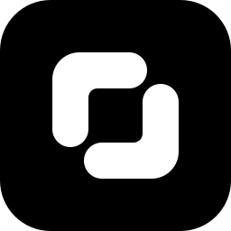
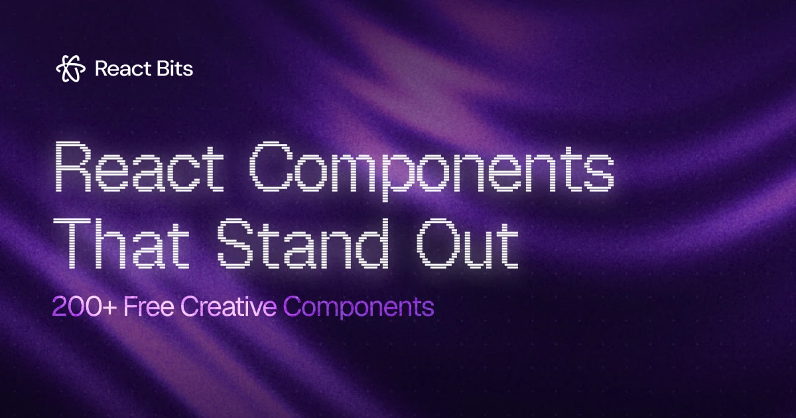

<div align="center">
  
  <h1>Col</h1>
  <p>A community directory of UI libraries, components, and design tools.</p>
  <p>
    <a href="https://usecol.com">Website</a> ·
    <a href="https://usecol.com/libraries">Libraries</a> ·
    <a href="https://usecol.com/components">Components</a> ·
    <a href="https://usecol.com/mcp">MCP setup</a>
  </p>
</div>

## What you can do

- Filter [libraries](https://usecol.com/libraries) by framework, category, and use case.
- Search [components](https://usecol.com/components) by name and open their official docs.
- Find [MCP servers](https://usecol.com/integrations) for UI libraries and design tools.
- Search the catalog from your coding agent with Col's MCP server.

Each library page lists supported frameworks, pricing, official links, and a setup prompt for coding agents. Component coverage is partial: if a component is missing, Col hasn't added it yet.

## Sponsors

<p align="center">
  <a href="https://reactbits.dev">
    
  </a>
</p>

<p align="center">
  Thanks to <a href="https://reactbits.dev">React Bits</a> for sponsoring Col.<br />
  <a href="https://usecol.com/sponsors">Become a sponsor</a>
</p>

## Use Col from your agent

Server URL: `https://usecol.com/api/mcp`. No account or API key needed.

Claude Code:

```sh
claude mcp add --transport http col https://usecol.com/api/mcp
```

Codex:

```sh
codex mcp add col --url https://usecol.com/api/mcp
```

Cursor (`.cursor/mcp.json`):

```json
{
  "mcpServers": {
    "col": {
      "url": "https://usecol.com/api/mcp"
    }
  }
}
```

| Tool | What it does |
| --- | --- |
| `search_libraries` | Find libraries by keyword, framework, category, or use case. |
| `search_components` | Find components by name. |
| `get_library` | Get a library's details and official links. |
| `get_component` | Get a component's sources and whether it can be previewed. |
| `render_component` | Show a live preview of a component in chat. |

Col also indexes documented components from Kobalte, SolidUI, shadcn-solid, Zaidan, hope-ui, RockSolid, Nikala UI, TorchUI, MagicUI Solid, and Mystic UI. Check each component's preview and compatibility details: Solid 1 and Solid 2 examples use separate pinned runtimes, and any preview limitations are disclosed. The [Quoin guide](docs/quoin-solid.md) covers its Solid 2 RC requirements.

Previews need a client that supports MCP Apps. See [component previews](docs/mcp-component-previews.md) for coverage, the [setup guide](https://usecol.com/mcp) for other clients, and the [agent guide](https://usecol.com/mcp/agents) for tool arguments. The [Col plugin](plugin/README.md) bundles the connection with a component search skill; use either the plugin or a direct connection, not both.

## Run it locally

Requires Node.js 24.22.1+ (below 25) and [Bun](https://bun.sh). The site builds
with Bun and runs on Node.

```sh
git clone https://git.cafe/collection-of-devs/col Col
cd Col
bun install
bun run dev
```

Before opening a pull request:

```sh
bun run typecheck
bun run test
```

`bun run dev` serves the site at `http://localhost:3000` in Cloudflare's Workers runtime. `bun run build` writes the Worker to `dist/server` and the prerendered pages and static files to `dist/client`; `bun run preview` serves that build locally.

The site reads two runtime variables. Locally, put them in a `.dev.vars` file at the repository root (it is git-ignored):

```sh
COL_MCP_ORIGIN=http://localhost:8787
COL_MCP_ALLOWED_ORIGINS=http://localhost:3000
```

`COL_MCP_ALLOWED_ORIGINS` is a comma-separated list of additional exact `Origin` headers to accept. This setting validates origins; it does not provide CORS preflight handling or response headers for cross-origin browser clients.

The MCP tools and component previews run as a standalone service in [`mcp-app/`](mcp-app) rather than inside the site's Worker: their verified preview payload is too large for a Cloudflare Worker. The site's `/api/mcp` route proxies to it. To exercise MCP locally, run `bun install` at the repository root, then `bun run start` inside `mcp-app/` (it listens on port 8787). The service imports `lib/`, which resolves packages from the repository root, so installing inside `mcp-app/` alone is not enough. Then set `COL_MCP_ORIGIN=http://localhost:8787` for the site, or point your MCP client at `http://localhost:8787/api/mcp` directly.

To host the service yourself, deploy `mcp-app/` anywhere Node 24 runs — [`mcp-app/Dockerfile`](mcp-app/Dockerfile) builds a self-contained image (Railway: set the Dockerfile path to `mcp-app/Dockerfile` with the repository root as the build context, and the healthcheck path to `/health`). Set `COL_MCP_ORIGIN` on the site to the service URL and configure `COL_MCP_ALLOWED_ORIGINS` as needed for requests with additional origins.

## Deploy the site

The site deploys to Cloudflare Workers as the `col` Worker ([`wrangler.jsonc`](wrangler.jsonc)). It uses the Workers static assets and Images bindings, which need no setup.

1. Run `bunx wrangler login` once.
2. Set `COL_MCP_ORIGIN` (the MCP service URL) and, if needed, `COL_MCP_ALLOWED_ORIGINS` under the Worker's **Settings → Variables and Secrets** in the Cloudflare dashboard. `keep_vars` stops deploys from removing them.
3. Run `bun run deploy` (build, then `wrangler deploy`). `bun run deploy:dry-run` builds and reports the upload size without deploying.

## Contribute

Code, issues, and pull requests live on [git.cafe](https://git.cafe/collection-of-devs/col). Read [CONTRIBUTING.md](CONTRIBUTING.md) before adding libraries, components, or code.

Check existing [issues](https://git.cafe/collection-of-devs/col/issues) first, then [open one](https://git.cafe/collection-of-devs/col/issues/new) per request:

- **Library:** name, official URL, supported frameworks, and what it offers.
- **Feature:** the problem and the result you expect.
- **Bug:** the page, steps to reproduce, what you expected, what happened, and your browser and OS. Leave out secrets and private information.

## Project structure

```text
app/          Routes (pages, API and discovery files) and the router
components/   UI components
data/         Libraries, components, and integrations
lib/          Search, MCP tools, and helpers
mcp-app/      Standalone MCP server (catalogue tools and component previews)
plugin/       Col agent plugin
public/       Brand and sponsor images
tests/        Tests
docs/         Project docs
```

Built with TanStack Start, React, TypeScript, Tailwind CSS, shadcn/ui, and Radix UI, and hosted on Cloudflare Workers. Licensed under [MIT](LICENSE).
