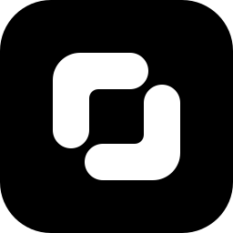

<div align="center">
  
  <h1>Col</h1>
  <p>A community directory of UI libraries, components, and design tools.</p>
  <p>
    <a href="https://usecol.com">Website</a> ·
    <a href="https://usecol.com/libraries">Libraries</a> ·
    <a href="https://usecol.com/components">Components</a> ·
    <a href="https://usecol.com/mcp">MCP setup</a>
  </p>
</div>

## What you can do

- Filter [libraries](https://usecol.com/libraries) by framework, category, and use case.
- Search [components](https://usecol.com/components) by name and open their official docs.
- Find [MCP servers](https://usecol.com/integrations) for UI libraries and design tools.
- Search the catalog from your coding agent with Col's MCP server.

Each library page lists supported frameworks, pricing, official links, and a setup prompt for coding agents. Component coverage is partial: if a component is missing, Col hasn't added it yet.

## Sponsors

<p align="center">
  <a href="https://reactbits.dev">
    
  </a>
</p>

<p align="center">
  Thanks to <a href="https://reactbits.dev">React Bits</a> for sponsoring Col.<br />
  <a href="https://usecol.com/sponsors">Become a sponsor</a>
</p>

## Use Col from your agent

Server URL: `https://usecol.com/api/mcp`. No account or API key needed.

Claude Code:

```sh
claude mcp add --transport http col https://usecol.com/api/mcp
```

Codex:

```sh
codex mcp add col --url https://usecol.com/api/mcp
```

Cursor (`.cursor/mcp.json`):

```json
{
  "mcpServers": {
    "col": {
      "url": "https://usecol.com/api/mcp"
    }
  }
}
```

| Tool | What it does |
| --- | --- |
| `search_libraries` | Find libraries by keyword, framework, category, or use case. |
| `search_components` | Find components by name. |
| `get_library` | Get a library's details and official links. |
| `get_component` | Get a component's sources and whether it can be previewed. |
| `render_component` | Show a live preview of a component in chat. |

For SolidJS 2 projects, Col covers [Quoin](https://usecol.com/docs/agents#solid-2-and-quoin) components with API details, usage examples and the exact dependency versions they need. The [Quoin guide](docs/quoin-solid.md) covers sources and coverage.

Previews need a client that supports MCP Apps. See [component previews](docs/mcp-component-previews.md) for coverage, the [setup guide](https://usecol.com/mcp) for other clients, and the [agent guide](https://usecol.com/mcp/agents) for tool arguments. The [Col plugin](plugin/README.md) bundles the connection with a component search skill; use either the plugin or a direct connection, not both.

## Run it locally

Requires Node.js 20.9+ and npm.

```sh
git clone https://git.cafe/collection-of-devs/col Col
cd Col
npm install
npm run dev
```

Before opening a pull request:

```sh
npm run typecheck
npm test
```

To let a browser client other than `https://usecol.com` call your MCP server, set `COL_MCP_ALLOWED_ORIGINS` to a comma-separated list of exact origins, for example `COL_MCP_ALLOWED_ORIGINS="http://localhost:3000"`.

## Contribute

Code, issues, and pull requests live on [git.cafe](https://git.cafe/collection-of-devs/col). Read [CONTRIBUTING.md](CONTRIBUTING.md) before adding libraries, components, or code.

Check existing [issues](https://git.cafe/collection-of-devs/col/issues) first, then [open one](https://git.cafe/collection-of-devs/col/issues/new) per request:

- **Library:** name, official URL, supported frameworks, and what it offers.
- **Feature:** the problem and the result you expect.
- **Bug:** the page, steps to reproduce, what you expected, what happened, and your browser and OS. Leave out secrets and private information.

## Project structure

```text
app/          Pages and API routes
components/   UI components
data/         Libraries, components, and integrations
lib/          Search, MCP tools, and helpers
plugin/       Col agent plugin
public/       Brand and sponsor images
tests/        Tests
docs/         Project docs
```

Built with Next.js, React, TypeScript, Tailwind CSS, shadcn/ui, and Radix UI. Licensed under [MIT](LICENSE).
