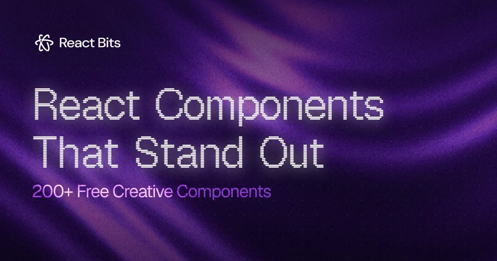

<div align="center">
  <picture>
    <source media="(prefers-color-scheme: dark)" srcset="public/brand/col-mark-white.png" />
    
  </picture>
  <h1>Col</h1>
  <p>A community-maintained directory of UI libraries, components, and tools for building interfaces.</p>
  <p>
    <a href="https://usecol.com">Visit Col</a> ·
    <a href="https://usecol.com/libraries">Libraries</a> ·
    <a href="https://usecol.com/components">Components</a> ·
    <a href="https://usecol.com/mcp">Connect your agent</a>
  </p>
</div>

## What is Col?

Col helps developers and designers find UI libraries that fit their projects. Search by framework, category, use case, or a specific component, then follow the library's official documentation to use it.

The catalog covers component libraries, animation tools, icons, and other interface resources. Each library has its own page with supported stacks, pricing, official links, and a setup prompt for coding agents.

- Browse and filter [libraries](https://usecol.com/libraries) by stack, category, and use case.
- Search [components](https://usecol.com/components) by name or alias, open their official docs, and inspect available previews.
- Ask your agent to render a chosen component live in chat with your labels, layout, and theme. This requires a client that supports MCP Apps.
- Save libraries in your browser to revisit later.
- Find [MCP servers and connectors](https://usecol.com/integrations) for UI libraries and design tools, with client-specific setup.
- Search the same catalog from your coding agent through Col's read-only MCP server.

Component coverage is partial. A missing result means Col has not indexed it, not that the library lacks it. Col links to official sources and states verification gaps. Library setup comes from the provider's documentation; listings that only provide outbound links omit setup shortcuts.

## Sponsors

Thank you to [React Bits](https://reactbits.dev) for sponsoring Col.

<a href="https://reactbits.dev">
  
</a>

React Bits provides animated React components, backgrounds, and text effects. The image above is their [official artwork](https://reactbits.dev/og.jpg).

Want to support the directory? See [sponsorship](https://usecol.com/sponsors).

## Connect Col MCP

Col's hosted MCP server lets agents search libraries, find verified component records, and inspect documentation and render components live in chat. It uses Streamable HTTP and requires no Col account or API key.

Server URL: **https://usecol.com/api/mcp**

For Claude Code:

```sh
claude mcp add --transport http col https://usecol.com/api/mcp
```

For Codex:

```sh
codex mcp add col --url https://usecol.com/api/mcp
```

For Cursor, add Col to `.cursor/mcp.json`, preserving any existing servers:

```json
{
  "mcpServers": {
    "col": {
      "url": "https://usecol.com/api/mcp"
    }
  }
}
```

Col exposes five tools:

| Tool | What it does |
| --- | --- |
| `search_libraries` | Find libraries by query, stack, category, or use case. |
| `search_components` | Find indexed components by name or alias. |
| `get_library` | Read a library's details, official links, and available documentation. |
| `get_component` | Inspect a component's sources and verification gaps. |
| `render_component` | Preview an actual library implementation by ID, with its package version and explicit reproduction limits. |

Search queries are keyword-based and limited to 4,096 Unicode code points. Stack filters use AND, including multiple frameworks; use-case filters use OR. Use structured filters and check requirements in official docs rather than treating prose or negation as hard constraints.

Call `get_component` and check `preview.available`, then call `render_component` with its `id`, optional user `styles` (CSS), and `theme` (`light` or `dark`). Col supplies the pinned real library export, required CSS and provider; implementation code and arbitrary imports are rejected. Both MCP Apps and the sandboxed HTML fallback display provenance and reproduction limits. Components without a verified adapter return `unavailable`, including copy-in sources not yet verified; there is no generated fallback. This is a breaking change from the former `code` argument. See the [rendering contract](docs/mcp-component-previews.md) for coverage and limitations.

See the [client setup guide](https://usecol.com/mcp) for all supported clients and the [agent guide](https://usecol.com/mcp/agents) for tool arguments and workflows. The [Col agent plugin](plugin/README.md) bundles the connection with a component discovery skill. Use the plugin or a direct connection to avoid configuring Col twice.

MCP requests without `Origin` remain supported. A supplied origin must match `https://usecol.com` or an explicit server-side `COL_MCP_ALLOWED_ORIGINS` entry. For self-hosting, set a comma-separated list of exact HTTP(S) origins in the deployment environment or `.env.local`, then restart/redeploy; for example, `COL_MCP_ALLOWED_ORIGINS="http://localhost:3000,https://client.example"`. Paths, trailing slashes, credentials, wildcards, opaque `null`, and multiple origins are rejected. Invalid entries grant no access. Host and forwarded-host headers never add trust. This policy does not enable CORS or add authentication; verify each browser client's origin before rollout.

## Run it locally

Requirements: Node.js 20.9+ and npm.

```sh
git clone https://git.cafe/screen/col Col
cd Col
npm install
npm run dev
```

Open the local URL printed in the terminal, usually `http://localhost:3000`.

Before submitting code or catalog changes:

```sh
npm run typecheck
npm test
```

`npm test` builds the site and runs the Node tests.

## Contribute

Col's code, issues, and pull requests live on [git.cafe](https://git.cafe/screen/col). Open issues and pull requests there. Vercel deploys from the [GitHub mirror](https://github.com/screen-gd/Col).

Read [CONTRIBUTING.md](CONTRIBUTING.md) before changing the catalog or code. It covers adding libraries, verified components, MCP servers, and connectors, along with the required checks.

### Request something

Search existing [libraries](https://usecol.com/libraries), [issues](https://git.cafe/screen/col/issues), and [pull requests](https://git.cafe/screen/col/pulls) first. Open one focused [issue](https://git.cafe/screen/col/issues/new) per request.

#### Request a library

Include its name, official URL, supported stacks, what it provides, the closest Col category and use cases, and confirmation that it is maintained and publicly accessible.

#### Request a feature

Explain the problem, the expected outcome, and any useful references.

#### Report a bug

Include the page or action, reproduction steps, expected and actual behavior, browser, operating system, viewport, and relevant screenshots or errors. Leave out secrets, tokens, and private information.

## Project structure

```text
app/                  Pages, API routes, metadata, and discovery outputs
components/           Directory UI, component previews, and shared controls
data/                 Libraries, verified components, integrations, and stories
lib/                  Search, MCP tools, client setup, and site helpers
plugin/               Col agent plugin and component discovery skill
public/               Brand assets and sponsor artwork
tests/                Build output and integration checks
docs/                 Architecture decisions and project documentation
```

Built with Next.js, React, TypeScript, Tailwind CSS, shadcn/ui, and Radix UI. See [CONTEXT.md](CONTEXT.md) for catalog terminology.

Col is licensed under the [MIT License](LICENSE).
