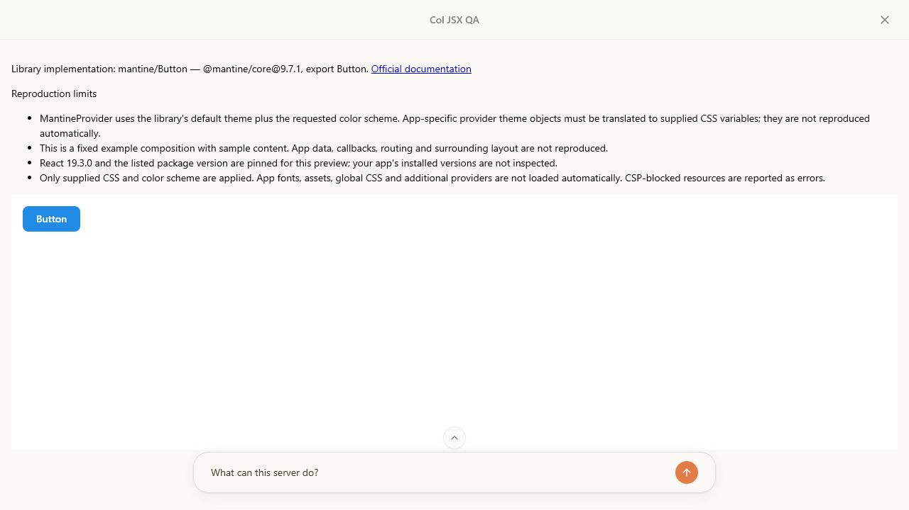
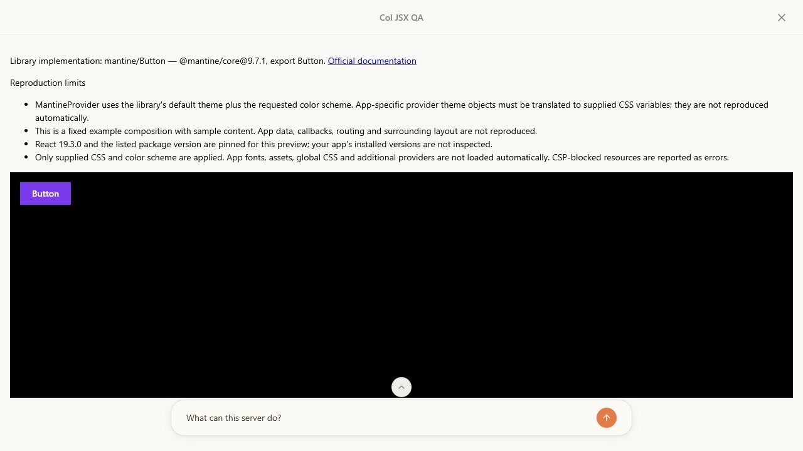
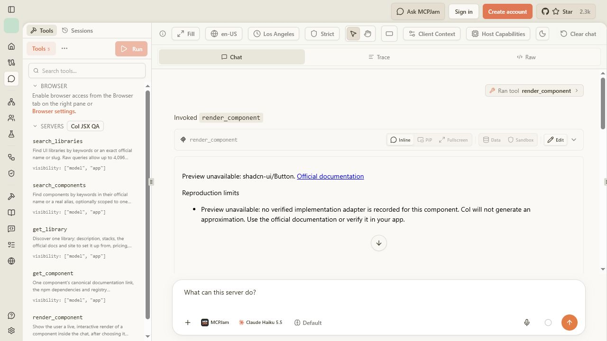
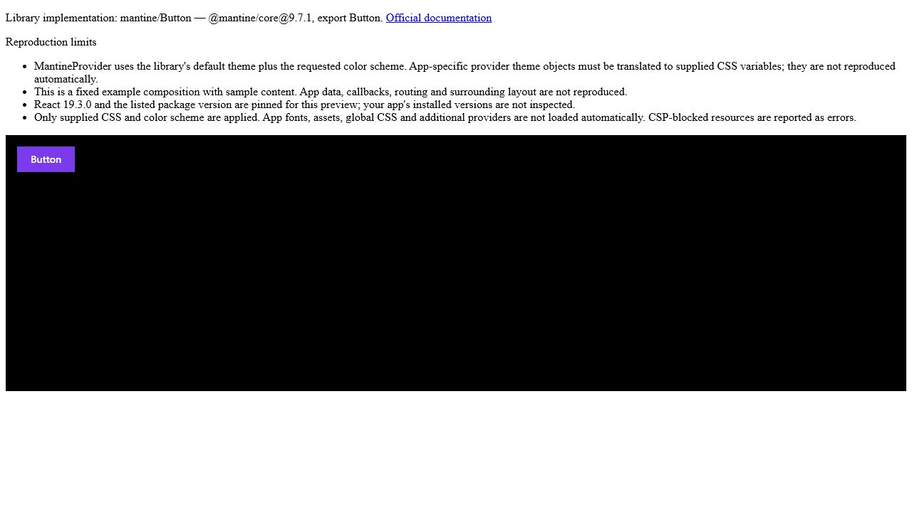

# Actual library previews — CoVe verification, 25 October 2026

## Result and contract

`render_component` now accepts a catalog ID and presentation options, not replacement JSX. It selects a pinned published export and the required CSS/provider from a reviewed registry. Eleven adapters are available: eight Mantine components and three Radix primitives. Every other catalog component explicitly reports unavailable. This is intentionally partial coverage, not a claim of pixel parity with an arbitrary app.

Both widget and HTML output keep package/version, official documentation and reproduction limits outside the styled execution frame. The supported API is documented in [the rendering contract](../mcp-component-previews.md). The former `code` API is rejected, including `code` supplied alongside a valid ID. Existing low-level compiler tests remain internal runtime coverage.

## Chain of Verification

The initial claim was split into questions that could disprove it. Source/contract review, emitted-bridge tests and actual client observations were checked separately.

| Verification question | Evidence and outcome |
| --- | --- |
| Could an agent still supply an imitation? | Strict schema rejects code-only calls, valid ID plus code, arbitrary package/source/props and invalid presentation options. The SDK transport test also rejects code instead of silently stripping it. |
| Does a supported preview run the package export? | All eleven generated compositions parse and import their recorded version/export. In MCPJam, all eleven mounted after real CDN loading; Mantine DOM contains its library classes, and real controls respond to input. |
| Could missing coverage silently use a similar primitive? | `shadcn-ui/Button` returns unavailable without code or an execution iframe. In the actual client it clears the prior component and displays the missing-adapter explanation. Outbound-only libraries are also blocked. |
| Do styles/theme apply without replacing behavior or hiding caveats? | The real Mantine Button changed to purple `rgb(124, 58, 237)` with `0px` radius. Requested dark mode produced `data-mantine-color-scheme="dark"` and a black body. CSS targeting `[data-col-provenance]` could not hide the outer disclosure. |
| Do security failures remain observable? | Under MCPJam Strict CSP, a user CSS import from example.com produced `Preview resource blocked by CSP: style-src-elem`. Removing it restored the Button. No CSP domains, sandbox permissions or eval allowances were broadened. |
| Can old results or errors overwrite corrected input? | An emitted-bridge test covers stale success, stale errors, same-ID corrections after rejected code/props/format, and reordered argument fields. Review caught and corrected a request-key collision before completion. |
| Does the fallback preserve the contract? | The complete returned HTML fragment was served unchanged in a minimal local page. Its real Mantine Button mounted with the same purple/zero-radius styling and visible provenance outside the sandbox. |

Independent Standards and Spec reviews found an obsolete `/llms.txt` paragraph and an error-correlation defect. Both were fixed. Spec review independently reran the emitted-bridge test and reported no remaining actionable finding.

## Actual client conditions and observations

Released MCPJam Inspector 3.16.2, its own client profile, Strict CSP, connected to local Col over HTTP. These were direct tool invocations and edits in its Playground, followed by inspection and interaction inside the actual MCP Apps frames. No model generation was needed. This is not evidence that every other MCP Apps host works.

| Adapter | Observed rendered content |
| --- | --- |
| mantine/Button | Button; library Button/UnstyledButton classes |
| mantine/Badge | BADGE |
| mantine/Checkbox | Accept terms; keyboard Space changed unchecked to checked |
| mantine/Switch | Notifications |
| mantine/TextInput | Name; typed value Ada persisted in the actual library input |
| mantine/Textarea | Message |
| mantine/Alert | Notice / Sample notification |
| mantine/Card | Sample card content |
| radix-ui/Checkbox | Accept terms |
| radix-ui/Switch | Notifications |
| radix-ui/Dialog | Open dialog; keyboard activation opened its real dialog, Close dismissed it |

Default light and custom dark presentation were checked. At MCPJam's phone preset the disclosure body's client width and scroll width were both 325px; the real Button remained visible. No new animation is introduced. A browser automation pointer limitation for fractional nested-frame coordinates was handled through keyboard activation rather than DOM mutation.

MCPJam's temporary input edits did not survive its fullscreen remount: it replayed the original request. A fresh tool invocation containing the dark/style arguments did retain them in fullscreen. The final dark screenshot is from that fresh invocation, not the temporary edited state.

## Automated checks

- Focused renderer suite: 17 passed, including SDK transport validation and the initialization-order CSP regression.
- Catalog/tool and renderer suite: 45 passed before the final added SDK assertions; the final renderer suite passed those assertions as well.
- `npm test`: production build and 133 tests passed.
- `npm run typecheck` and `git diff --check`: passed.

## Limits

The adapters use fixed sample compositions and pinned versions. App data, callbacks, routing, fonts, assets, surrounding layout, unsupplied CSS and additional providers are not reproduced. Mantine theme objects are not imported; CSS variables and light/dark are accepted. Radix is deliberately unstyled. Copy-in libraries require verified source adapters before they can render. CDN availability remains a dependency.

The prior broad MCP tests and the former source-input JSX tests are separately dated in the earlier reports. They were not all repeated for this API change. This run verifies every currently available adapter, not every catalog component's unavailable path in a browser, every interaction state, or every client's implementation.

## Screenshots

