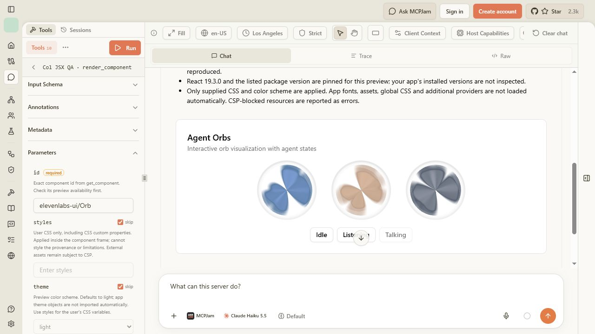
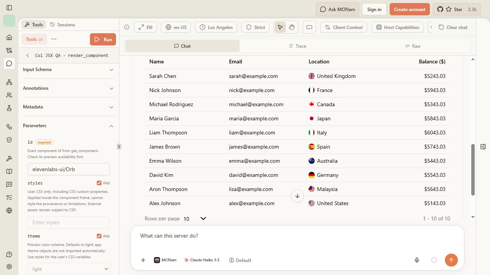
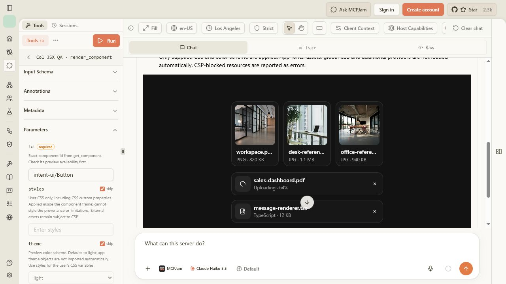
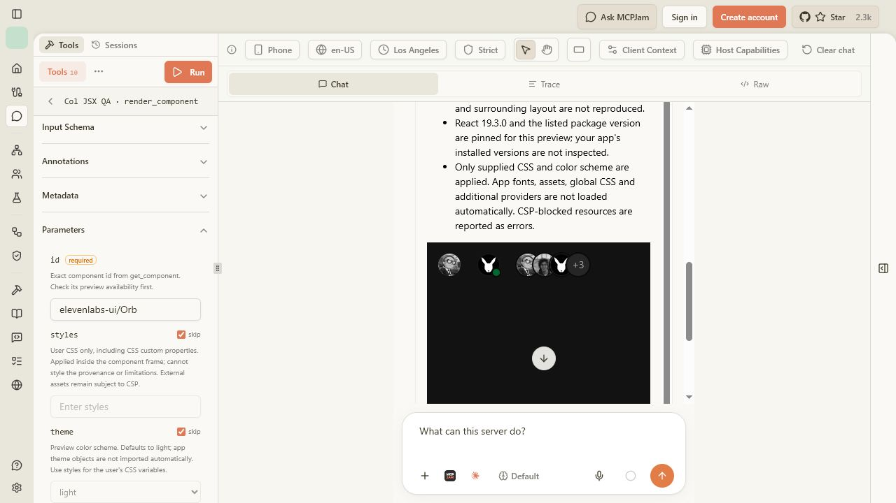

# Original preview dependencies and assets — CoVe, 25 October 2026

All nine cases from the previous audit now mount in MCPJam 3.16.2 with Strict CSP: four dependency failures and five missing-asset cases. The rendered implementations remain the actual upstream components. This closes those loading failures, not every possible interaction or application integration.

Follow-up: the [phone layout and picker report](mcp-preview-phone-picker-2026-10-25.md) fixes the horizontal overflow recorded below and records the user's confirmation that the file-selection dialog opens. File selection, replacement, removal and validation remain unverified. The observations below retain their original audit status.

The [browser observation ledger](preview-closure-client-results-2026-10-25.json) records baseline, intermediate, final and negative-control runs. The baseline was commit `191f02710c80b16f8dd3ac14443c8193fefd64ee`; the final runs used the production build containing this follow-up. MCPJam connected to the local Col `/api/mcp` endpoint and executed `render_component` through its Playground. Its real SDK bridge, resource loader and nested sandbox were used; the test did not inject a replacement component or a simulated client.

## Results

| Actual preview | Reproduced baseline | Final MCPJam result |
| --- | --- | --- |
| Intent UI Button | Pinned tailwind-variants CDN import failed | Original Button mounts with its actual dependency bundle. |
| ReUI File Upload | Pinned Lucide CDN import failed | Original upload control, icon and file input mount. File selection remains unverified; see limits below. |
| ReUI Data Grid | Pinned Base UI select CDN import failed | Original table mounts. Keyboard pagination displays rows 6–10; original Base UI selector changes page size to 10. All ten original flags decode. |
| ElevenLabs Orb | Drei/Fiber dependency graph failed to load | Three genuine WebGL canvases render the original shader. Listening and Talking controls change the selected state without a visible preview error. |
| shadcn Sidebar | Original avatar blocked | Original avatar decodes at 400×400. Collapse/expand works, with the original cookie persistence error explicitly disclosed. |
| shadcn Avatar | Original avatars blocked | All five displayed images decode from the three original assets. |
| shadcn Attachment | Three original photos failed to load | Workspace, Desk and Office photos decode at their original 900-pixel widths; light and dark previews checked. |
| shadcn Message | Original avatars blocked | All four displayed images decode from the two original repository assets. |
| Kibo Avatar Stack | Original avatars blocked | All four original avatars decode at 460×460. |

All nine final initial mounts had a hidden error/status element and real rendered content. A hidden element retaining the text `Rendering…` is not an error. We inspected actual DOM/image dimensions and visible screenshots, not just the MCP result's `sent-to-chat` status.

## Changes and source fidelity

- Supplemental bundles use genuine pinned npm packages restored with `npm ci` from a committed integrity lockfile. Eleven groups cover the missing dependency closures. React/ReactDOM remain shared; Base UI subpaths share one context and Drei/Fiber/Three share one dependency graph. The application dependency manifest did not gain runtime packages.
- ReUI's original dynamic icon-registry import initially compiled to an empty glob. A narrow, source-checked build adapter now resolves its original default Lucide registry, including all 380 original reexports. It does not invent icons or replace component behavior. Alternative icon-library customization is explicitly unsupported. Only the six ReUI entries in the generated source manifest changed; other source entries are unchanged.
- Thirty-three original images/textures total 1,048,789 bytes across seven previews. The additional two are Orb's original noise texture and Data Grid's original sample assets, discovered after fixing their imports. Images are embedded unchanged with original/download URLs, SHA-256, MIME type and attribution. Repository images have immutable source revisions; remote avatars/photos are identified as snapshots. Data Grid's fixed sample flags use a narrowly matched URL lookup; unknown URLs retain their original behavior under CSP.
- AST replacements operate on the selected original implementation before user CSS is appended. They change resource locations only. Tests invert the replacements and compare the remaining source byte-for-byte. Passive SVG flags are retained unchanged; active content or external references cause a rejection, not silent sanitization.
- Package provenance includes exact versions, npm integrity, source hashes and license notices. Two published tarballs lacked their notices; the retained notices come from their exact upstream git revisions. Builds fail if an emitted package lacks a retained notice. Original asset attribution is separate from package licenses.

## Chain of Verification

We challenged each implementation claim with a separate verification question, then corrected failures before the final rerun.

| Claim / question | Independent evidence and outcome |
| --- | --- |
| Are these actual upstream components and dependencies, or substitutes? | Source/hash checks, committed npm integrity lock, unchanged non-ReUI source entries, and independent source/license review. No component substitutes were added. |
| Does successful compilation imply a working client? | No. The first browser pass exposed ReUI's empty dynamic icon import plus Orb's texture and Data Grid's flags. These were fixed and the production build was tested again. |
| Are asset bytes and attribution preserved? | Offline verification of all 33 assets; hash-tamper and hostile-SVG rejection tests; exact source-replacement checks; decoded original images in MCPJam. |
| Do shared dependencies still share runtime contexts? | Bundle contracts plus real Base UI selection/pagination and real Three/Fiber Orb rendering and state controls. |
| Was CSP weakened to make the previews work? | Baseline and fixed execution policies/sandbox matched. An external URL supplied through user CSS still produced the expected visible `img-src` violation while the embedded original avatars decoded. |
| Are limitations hidden by successful initial mounts? | No. Sidebar's cookie error remains visible and now has an explicit reproduction-limit disclosure outside user CSS. File-picker automation did not complete and is not reported as passed. |

Independent Standards and Spec reviews found the omitted license notices during development. Those were fixed; follow-up reviews reported no actionable findings. The ReUI build adapter and Sidebar disclosure also received an independent review.

## Security boundary

The execution frame still uses exactly `sandbox="allow-scripts allow-forms"`. Its policy remains:

```text
default-src 'none';
script-src 'unsafe-inline' data: blob: https://esm.sh https://cdn.jsdelivr.net;
style-src 'unsafe-inline' data: blob: https://esm.sh https://cdn.jsdelivr.net;
img-src data: blob: https://esm.sh https://cdn.jsdelivr.net;
font-src data: blob: https://esm.sh https://cdn.jsdelivr.net;
media-src data: blob: https://esm.sh https://cdn.jsdelivr.net;
connect-src 'none'; frame-src 'none'; object-src 'none'; base-uri 'none'
```

No resource domains, `unsafe-eval`, same-origin permission, network permission or storage emulation were added. Source and asset disclosures remain outside the styled execution frame. A negative control using `https://example.com/col-csp-negative.png` in user CSS was blocked as expected.

## Checks and limits

- `npm test`: production build and **160/160 tests passed**.
- `npm run typecheck`: passed.
- Supplemental bundle tests: **12/12 passed**; original asset tests: **6/6 passed**; ReUI icon adapter tests: **2/2 passed**.
- `node scripts/build-preview-assets.mjs`: all 33 committed assets verified offline.
- `git diff --check`: passed.

The original Sidebar writes a cookie when toggled. Its state changes expanded → collapsed → expanded, but the browser rejects cookie persistence in an opaque sandbox and reports a `SecurityError`. This behavior is explicitly flagged; relaxing the sandbox or rewriting the original component would violate the requested boundary.

File Upload mounts with its original icon and native input. Attempts to exercise its picker encountered nested-frame automation coordinate failures and a file-chooser timeout, including after bringing the control into view. No file was selected, so upload, removal and file-validation interactions are **unverified**. This is a verification limit, not evidence that those interactions work or that the component is defective.

The phone preset also renders all five original Avatar images in dark mode. The surrounding provenance document has horizontal overflow (520-pixel scroll width inside a 351-pixel client width). This does not affect asset decoding, but the check is not a claim of fully responsive host layout.

The final nine-case rerun is narrower than the [earlier 22-library coverage pass](mcp-preview-expansion-2026-10-25.md). It does not claim that all 536 adapters, every MCP tool or every client were browser-tested again. The full suite checks source/import/compiler contracts for all adapters. Fixed sample data, pinned versions, host sandbox restrictions and the user's unsupplied app context still limit reproduction. MCPJam host telemetry/remount warnings were not treated as component failures or described as a globally warning-free console.

## Screenshots








