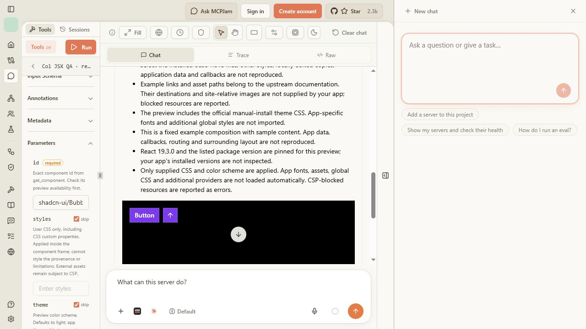
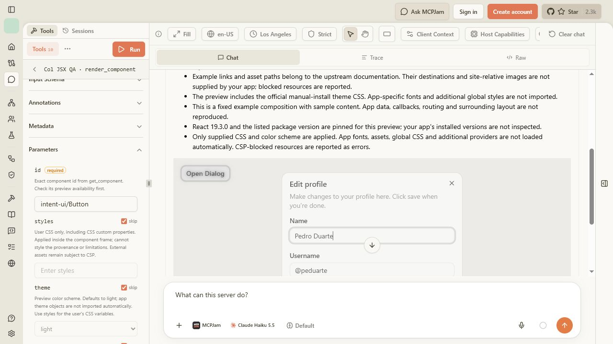
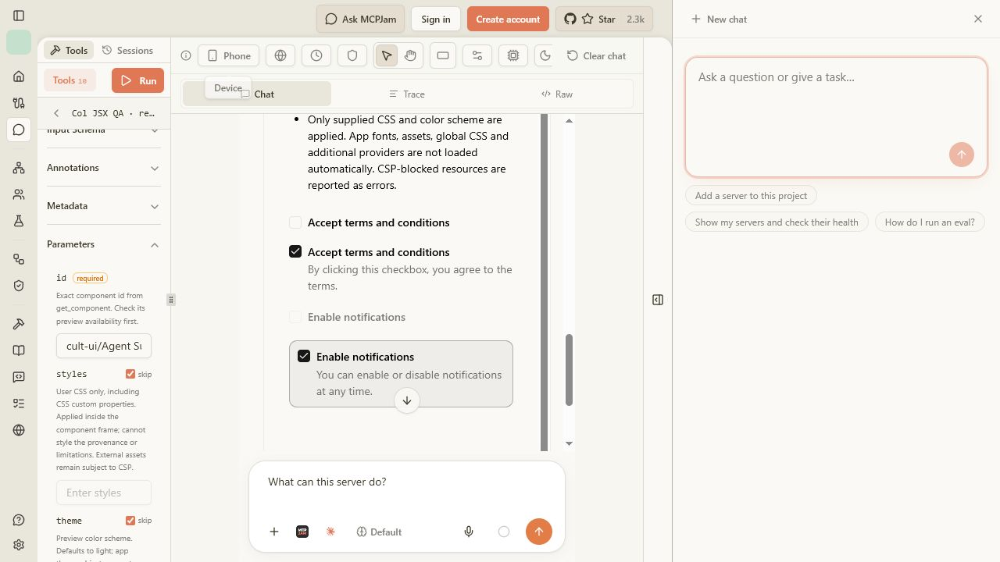
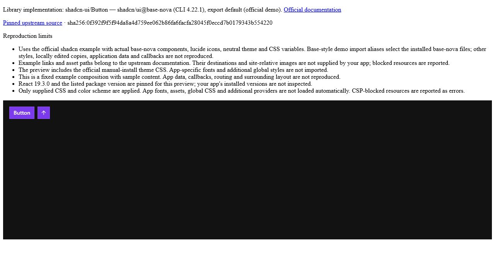

# Expanded real component previews — CoVe, 25 October 2026

## Scope

The adapter registry expanded from 11 to **536 of 1554 indexed component IDs across 22 libraries**, including **62 of 65 shadcn IDs**. This is source-backed adapter coverage. It is not a claim that all 536 were individually browser-tested or that every catalog library is supported.

| Library | Adapter coverage / indexed IDs |
| --- | --- |
| intent-ui | 6 / 6 |
| reui | 6 / 6 |
| elevenlabs-ui | 6 / 6 |
| web-awesome | 6 / 6 |
| magic-ui | 76 / 77 |
| shadcn-ui | 62 / 65 |
| base-ui | 20 / 37 |
| radix-ui | 17 / 30 |
| react-aria | 29 / 54 |
| ark-ui | 16 / 52 |
| headless-ui | 16 / 16 |
| mantine | 40 / 178 |
| mui | 32 / 128 |
| heroui | 15 / 72 |
| kibo-ui | 35 / 41 |
| cult-ui | 119 / 134 |
| cmdk | 1 / 1 |
| tween-ui | 8 / 8 |
| beui | 6 / 6 |
| loading-dev | 5 / 5 |
| hextaui | 8 / 8 |
| chakra-ui | 7 / 10 |

Unsupported IDs retain explicit library/component-specific reasons. Non-React runtimes, Next application services, absent source closures and redistribution restrictions are not replaced with approximations. Libraries with no indexed component IDs remain searchable as libraries.

## Chain of Verification

The implementation claims were separated from independent source review and actual client observations.

| Question that could disprove the claim | Check and correction |
| --- | --- |
| Is this the actual component? | Pinned npm exports or original upstream source/demo files, retained source hashes, dependency pins and licenses. Shadcn uses actual CLI-installed base-nova source and immutable official demos. No replacement implementation is accepted through the public schema. |
| Could a cached imitation acquire authentic provenance? | Independent review found unverified cache reuse. Source readers now reject altered cached/downloaded bytes against committed pins. Package builds restore tarballs with npm ci against integrity-complete lockfiles. A deliberate cached-file tamper was rejected without changing the generated output. |
| Does code that compiles actually mount? | Every shadcn source adapter and representatives of the other expanded libraries were called through MCPJam. This exposed CDN build failures, a Node-only process shim, missing theme context and a minified-code compiler defect. Corrections are recorded below; visible failures are not counted as passes. |
| Is dark mode supplied to the real provider? | Source demos use the actual next-themes ThemeProvider with forcedTheme and defaultTheme. Independent VM verification confirmed real demo/provider composition and zero remaining __dirname references. Shadcn Button computed dark scheme, black body and white text were observed in the client. |
| Are user styles applied without replacing source? | Real shadcn Button computed rgb(124,58,237), 0px radius, rgb(255,255,255) text and rgb(0,0,0) body. Outer provenance remained visible. |
| Do controls work as controls? | Shadcn Dialog opened with Enter and closed with Escape. Its notification checkbox changed aria-checked from false to true with Space. Base UI Dialog opened and closed. Filtering the real shadcn Data Table to ken99 left one matching row. These checks do not establish every interaction state of every adapter. |
| Does a narrow client break layout? | MCPJam Phone 430×932 preset: shadcn Checkbox preview had equal body clientWidth/scrollWidth (319px), with controls and disclosure visible. |
| Can unsupported or blocked content look falsely successful? | Aspect Ratio explicitly reported next/image unavailable and cleared the prior render. Avatar, Sidebar, Attachment and Message displayed visible missing-asset/CSP errors while preserving real upstream fallbacks. CSP domains and sandbox permissions were not broadened. |
| Does HTML output use the same implementation? | The unchanged HTML fragment from the tool was served locally. Its real shadcn Button mounted with the same requested purple background and square corners, with provenance outside the sandbox. |
| Does authentic source overwhelm model context? | Widget source is delivered through request-keyed result metadata, with source-free identity/limitations in text and structured content. In-memory MCP transport checks verify that separation and unchanged HTML fallback; bridge checks reject missing/stale source metadata. The [MCP Apps specification](https://github.com/modelcontextprotocol/ext-apps/blob/main/specification/2026-01-26/apps.mdx) defines metadata delivery to the view. |

## Actual client method

MCPJam Inspector 3.16.2, Strict CSP, connected to local Col at /api/mcp. Requests were entered/run in its Playground; rendered DOM, visible errors and selected interactions were inspected inside its real MCP Apps frames. No model-generated substitute or simulated host was used. Browser input occasionally hit the automation tool's fractional-frame limitation; keyboard interaction and fresh client views were used. A tool result alone was never treated as proof of successful rendering.

The [coverage ledger](preview-coverage-2026-10-25.json) records indexed availability. The [browser case ledger](preview-client-results-2026-10-25.json) records each tested ID, final visible status and rendered content. It includes failed attempts and retests. Representative checks cover library setup; they do not prove every component in those libraries. WebGL/media/device permissions and arbitrary user applications were not comprehensively exercised.

## Evidence

The case ledger contains **117 attempts of 86 distinct component IDs across all 22 adapter libraries**. Latest recorded outcomes: **77 clean mounts, five partial asset failures, four dependency failures**. All 62 shadcn adapters were exercised: **58 clean mounts and four partial asset failures**. These are mounting outcomes, not exhaustive interaction or pixel-parity certifications.

Remaining observed limits:

- Shadcn Avatar, Sidebar, Attachment and Message, plus Kibo Avatar Stack: original images/media could not load or were blocked by CSP. Actual fallback content remained visible with errors.
- Intent UI Button: `tailwind-variants@3.2.2` could not load; a direct bundled-leaf probe also returned HTTP 500 with a storage error.
- ReUI File Upload and Data Grid: pinned `lucide-react@1.17.0` and `@base-ui/react@1.5.0/button` CDN builds failed. Direct probes reported disk/storage failures. Alternate unqualified bundles resolved React 19.3.1, so they were not substituted for the shared 19.3.0 runtime.
- ElevenLabs Orb: `@react-three/drei@10.7.6` failed to load. The actual Voice Button example mounted; this does not verify the WebGL Orb.
- Three shadcn IDs and the remaining catalog entries without adapters explicitly remain unavailable. The coverage ledger distinguishes these from runtime dependency failures.

The final production build also delivered source through MCP Apps metadata successfully. Shadcn Questionnaire advanced from question 1 to question 2 after keyboard selection; Data Table filtering retained one matching row; Radix Accordion expanded and exposed its answer. The final custom Button still computed the requested purple background, square corners and white text. No CSP permission changed.

### Automated verification

- `npm run typecheck`: passed.
- `npm test`: production build and **146/146 tests passed**, zero skipped or failed.
- All 536 advertised adapters passed source/package identity and syntax checks. The 525 added package/source adapters also passed an independent assembly audit; all 12 npm bundles matched their code hashes and committed integrity-bearing lockfile, with zero bundler warnings.
- Five source-integrity tests cover altered caches, altered downloads, intentional refreshes and conflicting pins. Independent Standards and Spec follow-up reviews found no remaining actionable issues after cache integrity, process shim, theme context and metadata-delivery corrections.
- `git diff --check`: passed.

The committed package bundle artifact is approximately 5.57 MB. Only required bundles are sent for a selected preview, but real source/CSS can still produce multi-megabyte view payloads. This run did not benchmark latency or memory usage.

## Reproduction

Use the API and source build instructions in [the rendering contract](../mcp-component-previews.md). Call get_component to inspect availability before render_component. Keep the existing Strict CSP. Test both a successful example and an example with unavailable assets; do not remove its error to improve the screenshot.

The compiler regression uses the exact browser Sucrase version and emitted options: a minified return with optional/nullish operators threw `return_nullishCoalesce is not defined` under the former options; preserving modern JavaScript returns the expected fallback, zero and nonzero values.
