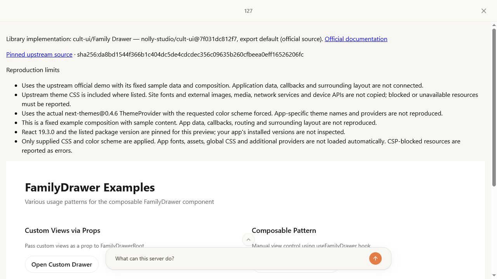
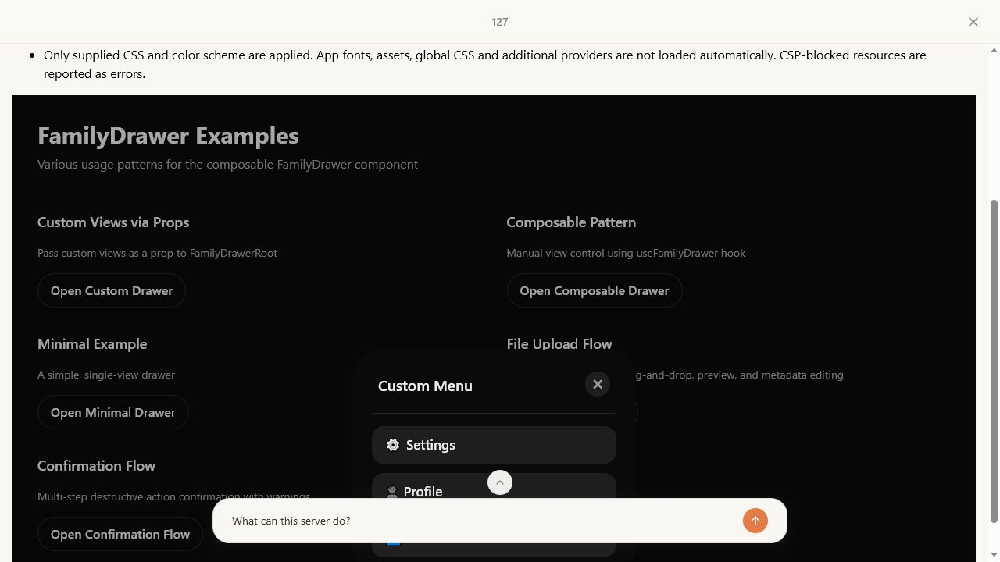
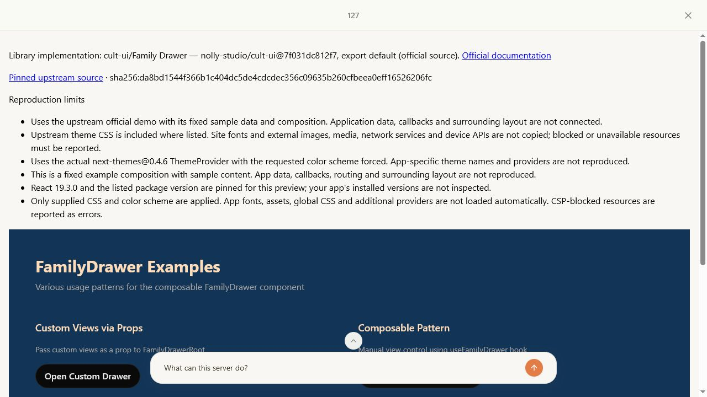
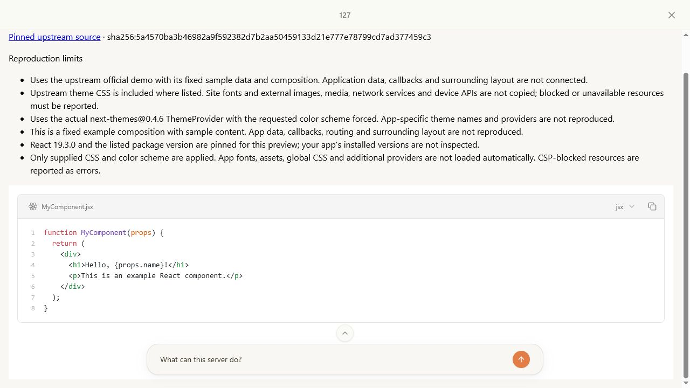
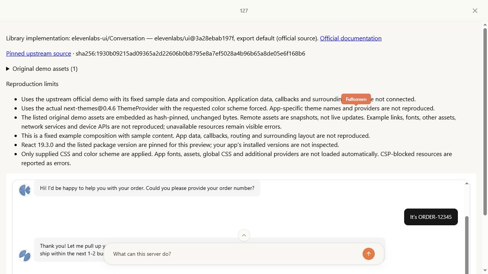
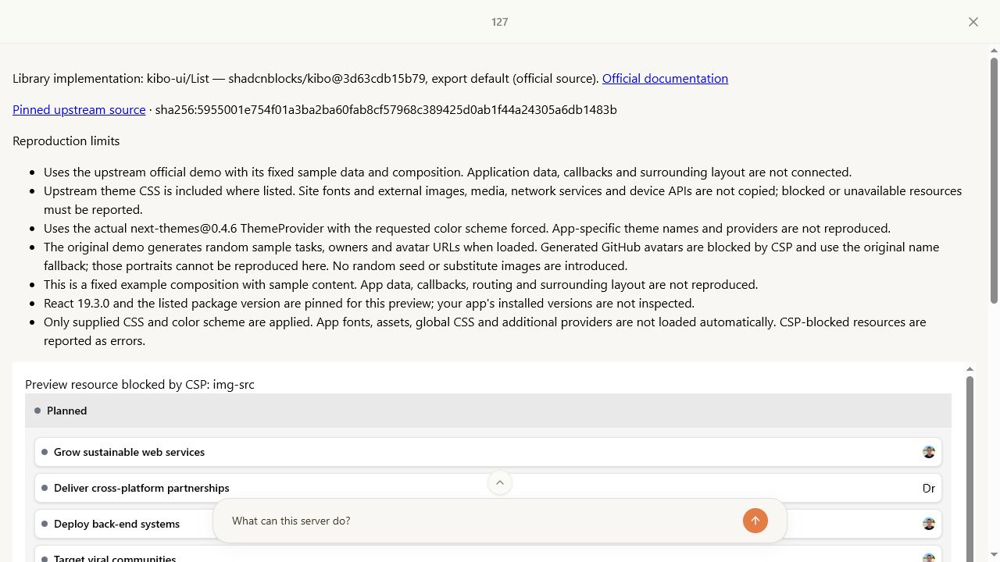
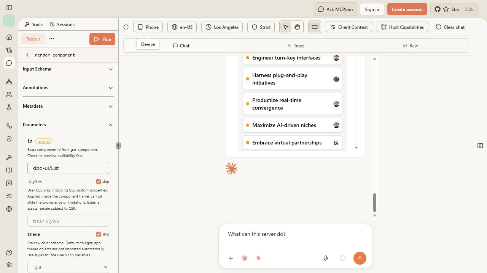

# Final MCPJam reruns and styling verification

The 55-ID repair queue from the [previous report](mcp-preview-remaining-2026-10-25.md) has been observed in MCPJam 3.16.2. Forty-eight examples finish without a visible runtime/resource error; seven retain explicit reproduction limits below. No IDs remain unobserved. This is initial-render and selected-interaction coverage, not a claim that every state or every user's app is identical.

## CoVe verification

1. Check the claim against the real client: invoke `render_component` through MCPJam's visible tool form, confirm its exact displayed source identity, and inspect the nested component frame and screenshot. Server success alone does not pass a render.
2. Challenge apparent failures: distinguish a still-visible rendering status, a blocked original resource, a browser-control timeout and an actual component error. Keep unsuccessful interaction attempts separate from observed state changes.
3. Compare the proposed fixes with source fidelity and CSP requirements. Independent review challenged the wrapper's CSS cascade, root sizing and fallback specificity. Keep all component source, package bundles and original asset bytes unchanged in this final follow-up.
4. Rebuild, then verify library light/dark colors, browser-default root sizing, explicit user CSS and an unstyled library's fallback in MCPJam Strict mode. Observe the large dependency previews in isolated sessions.

The sweep began on `97d2032`; representative checks after the final shared styling fix are identified separately in the [observation ledger](preview-final-reruns-2026-10-26.json). The entire 55-ID sweep was not repeated after this CSS-only correction.

## Final changes

- Put preview fallback colors and typography in the first, lowest-priority CSS layer. Previously, unlayered shell rules overrode genuine library base-layer background, foreground and font styles. Original library CSS now wins without rewriting it.
- Preserve the browser's 16px root size, including original 14px `text-sm` utilities. Keep a working black/white theme fallback for unstyled libraries. Supplied CSS remains last and applies only inside the component frame.
- Disclose Kibo List's random upstream Faker data and GitHub avatar restriction. Do not seed its random generator or replace blocked portraits.

| Actual-client check | Observed result |
| --- | --- |
| Cult Family Drawer, light | Body background `oklch(1 0 0)` and foreground `oklch(0.205 0 0)` equal the original library tokens; root 16px, sampled `text-sm` 14px. |
| Cult Family Drawer, dark | Body background `oklch(0.145 0 0)` and foreground `oklch(0.95 0 0)` equal the original dark tokens; root 16px. Custom Menu visibly opens. |
| Supplied user CSS | Exact computed background `rgb(18, 52, 86)` and foreground `rgb(254, 220, 186)`; provenance remains outside the styled frame. |
| Radix Checkbox | Dark fallback black/white; light fallback white/black. Root 16px. Actual unstyled Radix export and its styling limitation remain disclosed. |
| Cult Bg Animated Fractal Grid | Original dotted grid and configuration controls visible; rendering status hidden after settling. |
| Kibo Code Block | Original example and syntax highlighting render in an isolated session; no tab crash. |
| ElevenLabs Conversation | Original transcript and two orb visuals are visible in the final fullscreen screenshot; no tab crash. The earlier isolated run also recorded two 32×32 canvases. Nested DOM inspection timed out on this final run, so no new DOM count is claimed. |
| Cult Side Panel | Original open and close controls visibly toggle the panel. Remote YouTube SDK remains blocked and reported. |
| Phone preset (430×932), Kibo List | App frame client/scroll width both 366px; component viewport/scroll width both 319px, root 16px. No horizontal overflow in either frame. Avatar restriction and original name fallback remain visible. |

## Remaining reproduction limits

| Original example | Limit observed under unchanged CSP |
| --- | --- |
| Kibo Glimpse | Live metadata fetch fails; no fabricated title, description or image. |
| Kibo List | Random GitHub portraits can hit `img-src`; available original jsDelivr portraits load and the original name fallback remains. |
| Kibo Pill | One original upstream portrait is missing; available original portraits and the library fallback remain. |
| Kibo Sandbox | Sandpack editor mounts; external bundler/preview frame is blocked. Live code execution is not reproduced. |
| Kibo Video Player | Original approximately 72.6 MB media exceeds the 2 MB asset cap; controls mount but playback is unavailable. |
| Cult Bg Media | Original 21,093,317-byte video exceeds the asset cap; original background motion is unavailable. |
| Cult Side Panel | YouTube's remote SDK/frame is blocked; panel UI works but playback is unavailable. |

MCPJam initially compared three clients, mounting three copies of each preview. A host sandbox-proxy frame reached an extreme height; isolated single-client runs avoided that condition. Inspection of the pinned SDK and Col's 360–900px nested-height clamp did not establish a Col resize defect, so no speculative resizing change was made. These results do not establish multi-client memory stability.

The user confirmed that the file chooser opens and explicitly requested no further picker testing. No additional selection, replacement, removal or validation claim is made. Unchanged controls or automation timeouts (including Rating and Editor typing attempts) remain unverified; mounting is not counted as an interaction pass. No model API calls were needed: MCPJam's model label is not evidence of model access.

## Checks and evidence

- `npm test`: production build and 186/186 tests pass. The restricted build initially could not fetch Google Fonts; retry with network access passed.
- `npm run typecheck`: passes.
- `git diff --check`: passes.
- Final production diff changes only wrapper CSS defaults and List's disclosure. Upstream component source, original assets, dependency bundles, CSP origins and iframe permissions are unchanged from `97d2032`.
- Existing discovery routes, component IDs, sitemap, robots and page metadata require no changes. The rendering guide documents CSS precedence.

Screenshots show the actual MCPJam viewport, including host chat overlays where present; they are not edited component mockups.

