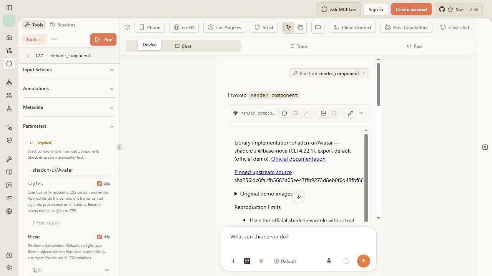
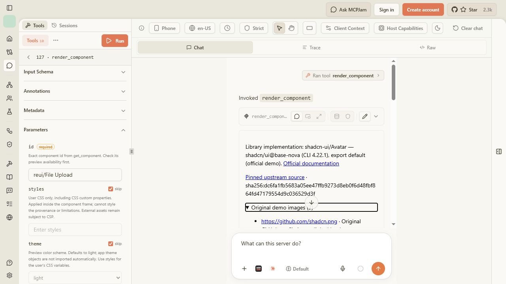

# Phone layout and file picker — CoVe, 25 October 2026

The provenance overflow is fixed. MCPJam's phone preset now fits the complete source hash and expanded original-asset URLs without horizontal scrolling. The original components, assets, CSP and sandbox are unchanged. The user manually confirmed that the ReUI file-selection dialog opens; selecting, replacing, removing and validating files remain unverified.

This follows the [dependency and asset report](mcp-preview-closure-2026-10-25.md). The baseline was commit `258d2eadc884b8b305dc2ea10f5a2d0172289dec`. Final observations used a production build with the wrapping fix, MCPJam 3.16.2 in Strict CSP mode, and its real Playground/SDK bridge connected to the local Col `/api/mcp` endpoint. See the [observation ledger](preview-phone-picker-results-2026-10-25.json).

## Reproduction and fix

Run `render_component` with `{"id":"shadcn-ui/Avatar","theme":"dark"}`, select MCPJam's Phone preset, and inspect the source hash and expanded “Original demo images” disclosure. Before the fix, an unbroken hash enlarged a 351-pixel document to 520 pixels. Original asset URLs also exceeded their list-item widths.

The shared provenance section now uses `overflow-wrap:anywhere`. It wraps long identifiers and links while preserving their complete text and link targets. The style applies outside the component execution frame and serves both the widget and HTML fallback. It does not clip evidence or restyle the library component.

## Chain of Verification

| Claim / verification question | Evidence and result |
| --- | --- |
| Does the fix address the measured overflow? | Baseline document: client width 351, scroll width 520. Final dark phone: 351/351 with details collapsed and expanded. |
| Do expanded details or light mode still overflow? | Light phone measurements had equal client/scroll widths of 366 pixels. Expanded disclosure paragraphs and list items had zero overflowing elements in both themes. Host scrollbar/remount state can vary the usable width; equality is the pass criterion. |
| Was text hidden to make the measurement pass? | The only layout change is wrapping on the provenance section. Complete source and asset hashes remain in the disclosure; the existing provenance test checks their presence and now checks the wrapping rule. The screenshot shows the wrapped hash. |
| Do genuine components and assets still render? | All five original shadcn Avatar images decoded in both themes, with natural widths 460, 460, 460, 408 and 460. No implementation, source bundle, dependency or asset file changed. |
| Was CSP relaxed? | Runtime policy matched the prior baseline, including `connect-src 'none'`, `frame-src 'none'` and the existing two CDN origins. Execution sandbox remained exactly `allow-scripts allow-forms`. No policy or permission code changed. |
| Does the picker actually open for a user? | The user manually confirmed that the native selection dialog opens in MCPJam. This verifies opening only. |
| Does failed automation establish a Col defect? | No. A plain native input successfully opened a chooser and selected the original avatar fixture. A minimal input inside nested sandbox frames failed browser automation independently of Col. MCPJam attempts encountered coordinate errors and chooser timeouts. This isolates a verification limitation, without proving the complete file lifecycle works. |

The disclosure was expanded using the keyboard. This change adds no animation or interaction behavior. The production build and source-level check cover both output formats; this follow-up did not repeat the HTML fallback browser check or the full catalog matrix.

## Picker coverage and remaining limit

The actual ReUI File Upload control mounts with its original icon and single-file `accept="image/*"` input. The user confirmed opening the selection dialog. No file was selected through the MCPJam automation, so image preview, replacement, removal, cancellation and invalid-file behavior are not reported as passed. The positive plain-input control is not a substitute for a successful MCPJam upload test.

The automation failure also reproduced in a separate minimal nested sandbox input, with “Click target is no longer available.” No source rewrite, synthetic file event, sandbox relaxation or CSP change was used to bypass that limitation. Completing the remaining lifecycle checks requires manual interaction or browser control that supports this nested native chooser.

## Checks

- `npm test`: production build and **160/160 tests passed**. Build-time remote metadata requests emitted sandbox network warnings; the build completed.
- `npm run typecheck`: passed.
- `git diff --check`: passed.
- Focused diff review: wrapping style, explanatory comment, existing provenance-test assertion and QA evidence only.
- No routes, tool inputs, catalog entries or discovery behavior changed; discovery metadata needs no update for this layout fix.

## Screenshots

Before: the source hash extends beyond the phone document.

After: the complete hash wraps and expanded provenance fits.

