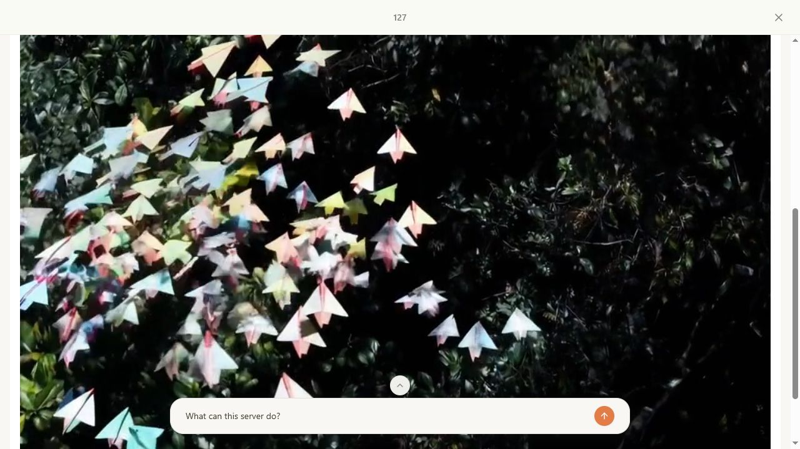
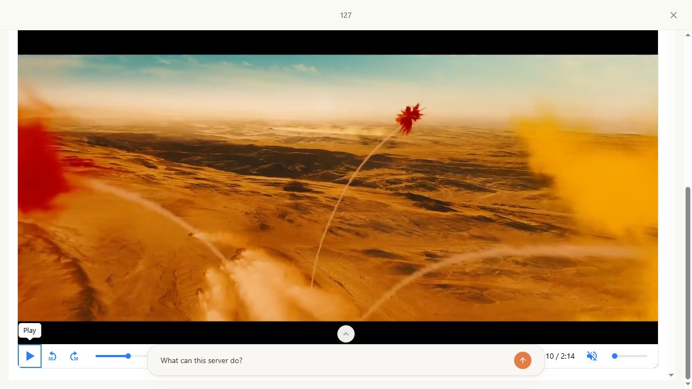
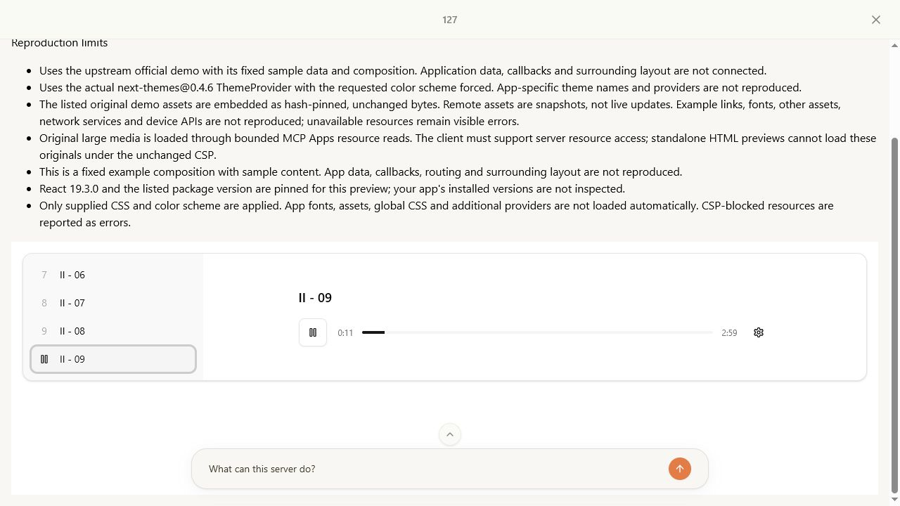

# Original media resource follow-up — 27 October 2026

This follows the [55-ID rerun report](mcp-preview-final-reruns-2026-10-26.md). That report's seven limits describe its historical queue, not all catalog limitations. This change restores the original videos for **Cult Bg Media** and **Kibo Video Player**, and captures seven previously oversized original **ElevenLabs Audio Player** tracks. The component source, existing inline assets, dependency bundles, CSP origins and iframe sandbox permissions are unchanged. The file picker was skipped.

## CoVe: claims and independent checks

| Claim | Verification question | Evidence / result |
| --- | --- | --- |
| These are the upstream originals | Are URLs still present in the pinned demo, and do local files match the recorded bytes and hashes? | Offline builder and focused tests verify all nine files, source revisions, full SHA-256, container validity and chunk hashes. Only exact URL literals are relocated; no transcoding, replacement footage or demo-data changes. |
| Large files can reach the view without a huge tool response | Is every resource response bounded, with no arbitrary path or network proxy? | A fixed `col://preview-media/{sha256}/{part}` manifest serves at most 1,500,000 binary bytes / 2,000,000 base64 characters per read. Unknown hashes, noncanonical/out-of-range parts, truncation, corruption and oversized responses fail. |
| Media does not bloat executable source | Does the compiler receive the original videos or the new MP3 bytes? | Media is separate from source and model-facing text. Kibo's metadata is 478,803 bytes; its original video arrives in 49 resource reads. An earlier single-response prototype was rejected because it produced approximately 97 MB of metadata. |
| A stale load cannot replace a later preview | What happens with identical reruns or A → B → A input while reads are pending? | Deferred VM tests complete loads in reverse order: only the newest generation mounts. Both request identity and a monotonic generation guard are checked after awaits. |
| Successful transport means actual playback | Can the original controls advance decoded media in MCPJam? | Actual UI observations below, separate from file/container tests. |
| CSP is preserved | Do blocked external integrations remain blocked? | In MCPJam, Side Panel opens and closes in dark mode, while its YouTube SDK still produces `Preview resource blocked by CSP: script-src-elem`. Source diff retains CSP origins and `allow-scripts allow-forms`. |

## Actual client verification

Production build on port 3100, MCPJam **3.16.2**, **Strict CSP**, Claude client emulation. These are direct tool-form executions; no model API calls. Large examples were opened in isolated sessions. The browser's screenshot path was used when its DOM automation could not serialize the large data URL.

| Component | Original media | Observed behavior |
| --- | --- | --- |
| Cult Bg Media | 21,093,317-byte `paper-planes.mp4` | Decoded at 1280 × 720, played to its original 20-second end, restarted through the original Play control, advanced to 12.2748 seconds, and paused at 5.1633 seconds in another restart. |
| Kibo Video Player | 72,619,954-byte original Mux MP4 | Original Media Chrome toolbar reports 2:14. Keyboard focus reached its own Play control; Space started changing footage, then Space paused and the original Play control returned. DOM state inspection hit the browser automation message-size limit; screenshots and keyboard interaction establish this result, not a fabricated DOM measurement. |
| ElevenLabs Audio Player | Seven restored original MP3s, 20,537,876 bytes total, plus three existing originals | All ten entries selected through original keyboard controls. Each displayed decoded duration and advancing elapsed time; track 09 paused through its original control. No assertion of audible output. |

Observed audio times are individual screenshots, not a full-duration playback claim:

| Track | Elapsed / duration | Resource status |
| --- | --- | --- |
| 00 | 0:16 / 1:37 | Restored |
| 01 | 0:06 / 3:24 | Restored |
| 02 | 0:12 / 1:09 | Existing control |
| 03 | 0:11 / 1:09 | Existing control |
| 04 | 0:14 / 1:25 | Restored |
| 05 | 0:12 / 1:39 | Restored |
| 06 | 0:11 / 0:29 | Existing control |
| 07 | 0:14 / 1:54 | Restored |
| 08 | 0:11 / 2:59 | Restored |
| 09 | 0:11 / 2:59; then paused at 0:19 | Restored |

The HTML negative control returned a visible unavailable result explaining the Apps resource requirement, rather than a broken player or substitute media. The [observation ledger](preview-resource-results-2026-10-27.json) includes measurements, hashes, timestamps and per-track screenshot paths. This targeted pass does not repeat the prior 55-ID queue.

## Remaining limits

Five of the earlier seven queue limits remain. They cannot be truthfully removed by the same fixed-file relocation:

- **Glimpse:** the original asynchronous demo fetches a live website for metadata. Replacing it with static invented metadata changes its behavior.
- **List:** upstream Faker generates random GitHub portraits across a huge ID space. Seeding its data or substituting avatars changes the original demo.
- **Pill:** the original upstream portrait returns 404; no original image bytes were recovered.
- **Sandbox:** Sandpack needs an external bundler, frame and supporting runtime. A static file snapshot does not reproduce it under the present CSP.
- **Side Panel:** the panel works, but YouTube's external SDK and frame remain blocked. A substitute video would not be the original integration.

Other already-disclosed catalog limits remain, including microphone capture, cookie persistence, live tweets, other missing original assets and YouTube dialogs. This is not a claim that every component, state, library or client has been fixed or tested.

## Costs and compatibility

- Nine binary snapshots add **114,251,147 bytes** to the repository and deployment. The production MCP trace contains all nine; its unique traced files total **205,051,698 bytes**. No deployment was performed.
- Bounded responses avoid one oversized transport response; the browser still downloads, assembles and retains the full original media as data URLs. The Kibo video alone becomes roughly 97 MB of base64, with additional browser copies and decode memory. Multi-client memory stability is not established.
- The three large-media examples require an MCP Apps client supporting `resources/read`. Their standalone `format: "html"` result is explicitly unavailable. Other HTML previews retain their existing behavior. No substitute or silent downgrade is returned.
- All original media retains its upstream attribution. The snapshot records do not assert a separate media license.

## Automated verification

- Red-before-fix original-media probe, then green with verified assets.
- Focused resource/widget/source tests: **36/36 passed**.
- `npm test`: production build and **189/189 tests passed**.
- `npm run typecheck`: passed after the build.
- Offline `node scripts/build-preview-media.mjs`: all nine original files verified.
- A nonfatal Turbopack cache persistence warning occurred when the workspace disk filled during the build. The build and tests completed successfully; the generated cache was preserved in OS temporary storage to recover workspace space.

The independent read-only review found the builder's reused-source identity check and the same-input asynchronous race; both were fixed and verified. The final independent review found no remaining concrete blocker in the production diff. Sanitized measurements and client observations are published with this report; private launch tokens, media payloads and debug logs are excluded.
